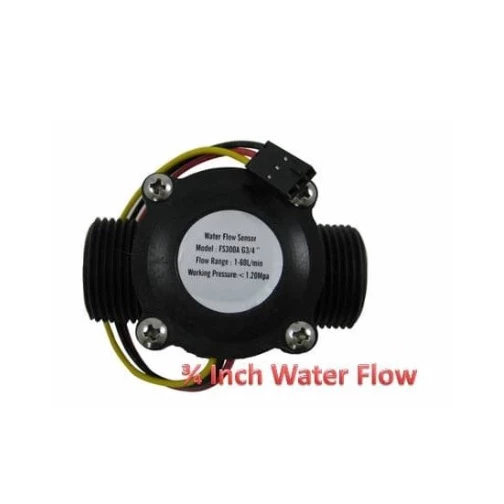
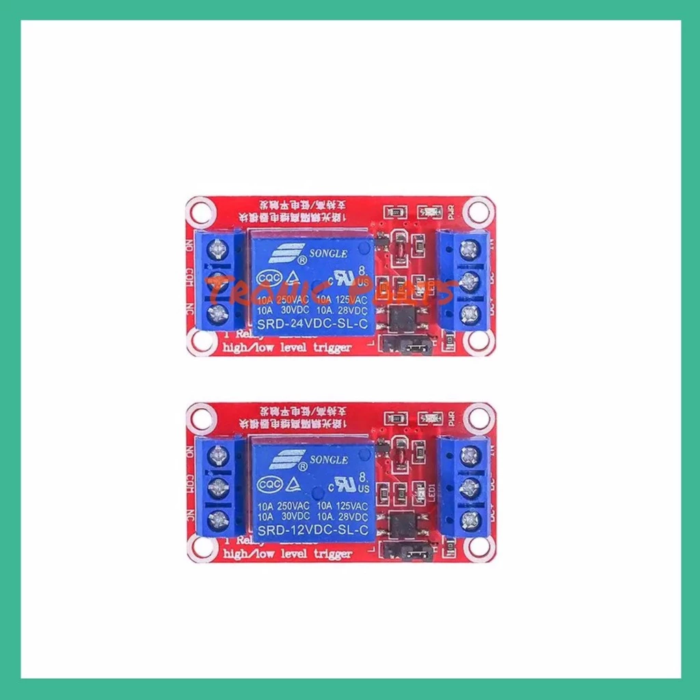
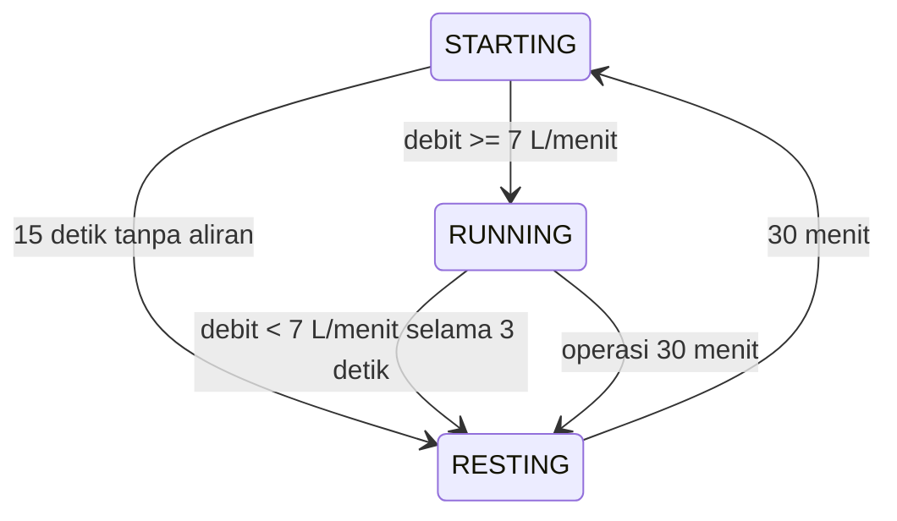

# Proteksi Dry Run Pompa Air

Sketch Arduino untuk mengendalikan pompa air melalui relay dan mendeteksi kondisi
dry run menggunakan sensor aliran FS300A. Pompa hanya dipertahankan menyala jika
aliran air memenuhi batas minimum dan batas operasi maksimal.

## Fitur

- Pompa langsung memulai saat Arduino dinyalakan.
- Menunggu aliran awal selama maksimal **15 detik**.
- Mematikan pompa jika aliran berada di bawah batas minimum selama **3 detik**.
- Membatasi satu siklus operasi pompa hingga **30 menit**.
- Menunggu **30 menit** sebelum mencoba menyalakan pompa kembali setelah berhenti.

> **Catatan:** Ini adalah konfigurasi awal dan dapat diubah pada variabel di dalam kode.

- Menghitung debit dan total volume air pada siklus aktif.
- Menampilkan status dan countdown melalui Serial Monitor.
- Menampilkan status pompa menggunakan LED bawaan Arduino:
  - Berkedip lambat: `RESTING`
  - Berkedip cepat: `STARTING`
  - Menyala terus: `RUNNING`

## Perangkat keras

- Arduino yang memiliki interrupt eksternal pada pin 2, misalnya Arduino Uno
- Sensor aliran FS300A [(Link Pembelian)](https://shopee.co.id/Water-flow-sensor-Meter-3-4-FS300A-Control-1-60L-min-3-4-Inchi-i.760686534.17978043819)\

- Modul relay yang sesuai dengan tegangan logika Arduino [Link Pembelian](https://shopee.co.id/Relay-5V-1-Channel-Module-High-Low-Level-Trigger-Opto-Isolation-1-CH-i.998676343.24400490282)\

- Pompa air dan catu daya pompa yang sesuai
- Kabel jumper

### Wiring

| Komponen | Pin Arduino | Keterangan |
| --- | ---: | --- |
| Sinyal FS300A | D2 | Input interrupt, menggunakan `INPUT_PULLUP` |
| Input relay | D8 | Output kendali pompa |
| VCC FS300A | 5V | Sesuaikan dengan spesifikasi sensor |
| GND FS300A | GND | Ground bersama Arduino |

Hubungkan pompa ke terminal relay sesuai rating tegangan dan arus modul.
Jangan menghubungkan beban listrik bertegangan tinggi langsung ke pin Arduino.
Pemasangan bagian listrik AC harus dilakukan oleh teknisi yang kompeten.

## Cara menggunakan

1. Buka `Proteksi_DryRun_PompaAir.ino` di Arduino IDE.
2. Pilih board dan port Arduino.
3. Pastikan sensor aliran dan relay telah terhubung sesuai wiring.
4. Upload sketch.
5. Buka Serial Monitor pada baud rate **9600**.
6. Pastikan pompa, arah aliran, dan pembacaan debit bekerja dengan benar.

## Siklus kerja



Saat memasuki `RESTING`, relay dimatikan. Setelah masa istirahat selesai,
Arduino mencoba menyalakan pompa kembali secara otomatis.

## Konfigurasi

Parameter utama berada di bagian atas sketch:

| Konstanta | Nilai awal | Fungsi |
| --- | ---: | --- |
| `FLOW_PIN` | `2` | Pin sinyal sensor aliran |
| `RELAY_PIN` | `8` | Pin kendali relay |
| `RELAY_ON` / `RELAY_OFF` | `HIGH` / `LOW` | Logika modul relay |
| `FLOW_FACTOR` | `5.5` | Hubungan frekuensi sensor dengan debit |
| `MIN_FLOW_LPM` | `7.0` | Debit minimum dalam L/menit |
| `START_TIMEOUT_MS` | `15000` | Batas deteksi aliran awal |
| `LOW_FLOW_MS` | `3000` | Durasi toleransi debit rendah |
| `MAX_RUN_MS` | `30 menit` | Durasi maksimum satu siklus |
| `REST_MS` | `30 menit` | Jeda sebelum percobaan berikutnya |
| `SAMPLE_MS` | `1000` | Interval pembacaan sensor |
| `ALWAYS_SHOW_FLOW` | `false` | Tampilkan debit juga saat `RESTING` |

Nilai `FLOW_FACTOR` adalah asumsi awal. Kalibrasikan berdasarkan sensor dan
instalasi aktual agar pembacaan debit serta deteksi dry run sesuai kondisi
lapangan. Jika relay bersifat active-low, tukar nilai `RELAY_ON` dan
`RELAY_OFF`.

## Format output Serial

Contoh output:

```text
Pompa ON: total air direset, menunggu aliran.
Aliran terdeteksi.
Status: RUNNING | Sisa operasi: 29:58 | Debit: 8.12 L/menit | Total siklus: 0.14 L
```

Pesan penghentian menunjukkan penyebabnya, misalnya:

- `Aliran awal tidak terdeteksi`
- `Aliran rendah / tidak ada`
- `Batas operasi 30 menit tercapai`

## Catatan keselamatan

Sistem ini adalah proteksi berbasis perangkat lunak dan tidak menggantikan
pengaman listrik, thermal overload, sekering, grounding, atau emergency stop.
Uji sistem tanpa beban dan verifikasi logika relay sebelum menghubungkan pompa.
